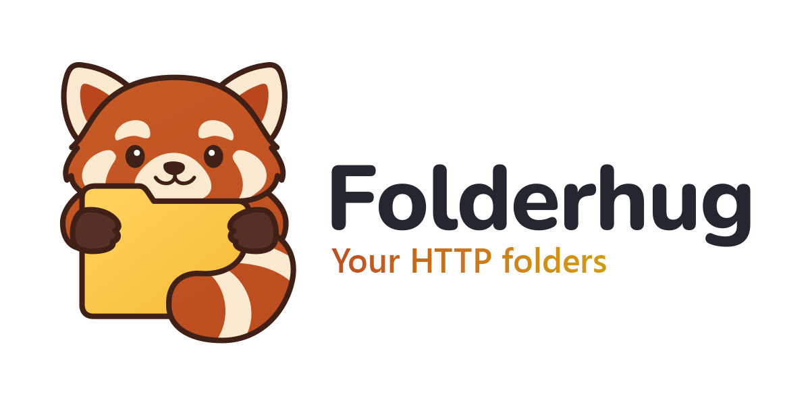
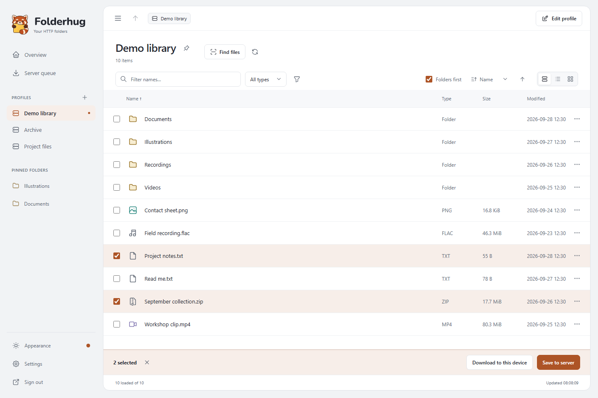
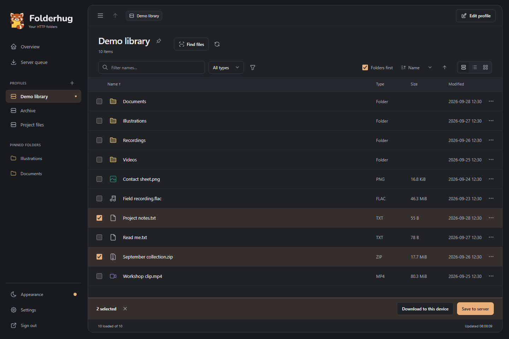
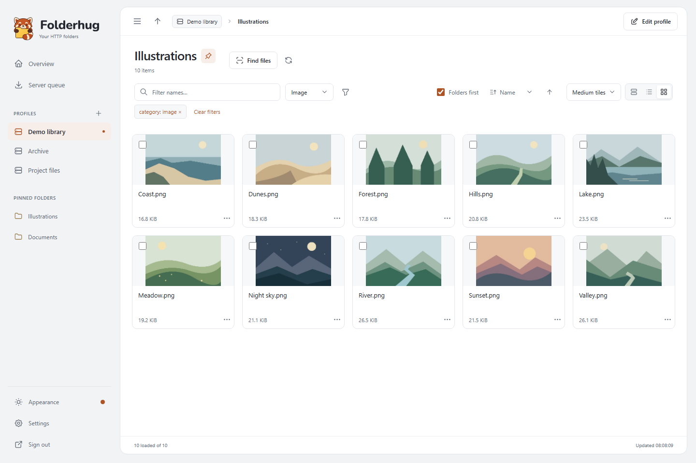
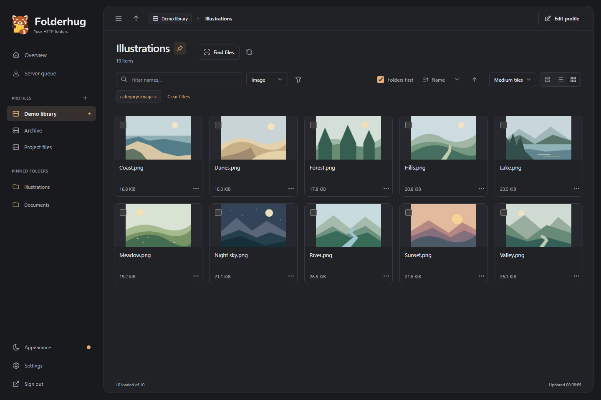

# Folderhug

<picture>
  <source media="(prefers-color-scheme: dark)" srcset="docs/assets/banner-dark.jpg">
  <source media="(prefers-color-scheme: light)" srcset="docs/assets/banner-light.jpg">
  
</picture>

Folderhug is a self-hosted file explorer for HTTP directory listings, such as a seedbox's download folder. Add your sources, browse and search their folders, preview supported media, and download files to your browser or server. Folderhug leaves the source files unchanged.

You can switch between list and grid views, filter a folder, pin folders, and use Find files to search subfolders. Folderhug has one owner account. Image thumbnails work in the app. Audio and video playback depends on your browser and the file's codec.

**This is a new project and I'll update it and add new features as much as I can**

## Screenshots

Default Amber in light and dark mode, using synthetic files and illustrations. The first row shows file selection and download actions; the second shows grid thumbnails and image filtering. Click a screenshot to open it at full size.

| Light mode | Dark mode |
| --- | --- |
| [](docs/assets/screenshots/details-light.png) | [](docs/assets/screenshots/details-dark.png) |
| [](docs/assets/screenshots/grid-light.png) | [](docs/assets/screenshots/grid-dark.png) |

## Install with Docker Compose

On a Linux host with Docker Compose, download the Compose file:

```sh
mkdir folderhug
cd folderhug
curl -fL https://raw.githubusercontent.com/themartz90/folderhug/main/compose.yaml -o compose.yaml
```

If you want to save files in a host folder, add the optional [mount below](#downloads) to `compose.yaml` now. Then start Folderhug:

```sh
docker compose up -d
```

Open `http://localhost:48321` on the server, or `http://SERVER-IP:48321` from a device on your LAN. Create the owner password in the browser. Anyone who can reach a fresh installation can claim the owner account, so finish setup before sharing the address or exposing it outside your trusted network. The app creates its credential key on first start.

The default host port is `48321`, chosen to reduce clashes with other self-hosted apps. Set `FOLDERHUG_PORT` to use another port.

The default Compose file pulls `ghcr.io/themartz90/folderhug:latest`. You do not need a `.env` file for ordinary LAN access. See [operations and backups](docs/OPERATIONS.md) for a custom address, an HTTPS reverse proxy, updates, or a source build.

## Downloads

**Download to this device** (called **Download** in file details) sends a file to your browser's download manager. It saves on your device and needs no host mount. Folderhug can request the download but cannot tell when your browser finishes saving it.

**Save to server** adds a persistent job to Server queue. Without a host mount, files go into Folderhug's `/downloads` volume. You can also add an existing server folder to the destination picker. Under `services.app.volumes` in `compose.yaml`, keep the existing entries and add a bind mount such as:

```yaml
- /mnt/drive:/mnt/drive:rw
```

Confirm `/mnt/drive` exists on the Docker host before starting; short bind syntax can create a missing host directory. Give the container's UID/GID 10001 write access to the folder. Run `docker compose up -d` after adding the mount. **drive** then appears in **Save to server**. Mounted jobs use `/downloads` for temporary storage, so keep that volume and enough space for the file. See [download details](docs/DOWNLOADS.md) for multiple mounts, resume behavior, and missing-path checks.

## API

Use the `/api/v1` API to browse and filter folders, run bounded scans, search the local index, and export scan results as JSON or CSV. Scripts can also stream files, queue server downloads, and check or control their jobs.

Create an API token in **Settings**, choosing the profiles and permissions your script needs. Token-based downloads save to Folderhug's server downloads directory; saving to mounted host folders requires an owner session.

See the [API usage guide](docs/API_USAGE.md) for authentication, permissions, and PowerShell examples, or the [OpenAPI specification](api/openapi.yaml) for the full endpoint contract.

## Limits and further reading

- Standard Apache table/preformatted and nginx listings are supported. Custom listing pages may need a parser change.
- Find files lets you search the current folder or its subfolders. Crawls are explicit and bounded; filtering the resulting files does not start another crawl.
- Temporary source credentials stay in server memory. Remembered credentials are encrypted with a key stored outside the database.
- There are no uploads, upstream rename/delete actions, public shares, multiple user accounts, telemetry, or transcoding.

Read [source compatibility](docs/COMPATIBILITY.md), [API examples](docs/API_USAGE.md), and [Windows development](docs/DEVELOPMENT.md) for details. Native development does not need Docker or WSL. Runtime settings use the `FOLDERHUG_` prefix.

## License

[Contributing](CONTRIBUTING.md) covers development changes. See [Security](SECURITY.md) for vulnerability reporting and deployment boundaries. Project code uses the [MIT license](LICENSE); dependencies retain their own licenses, listed in [third-party notices](docs/THIRD_PARTY_NOTICES.md).
